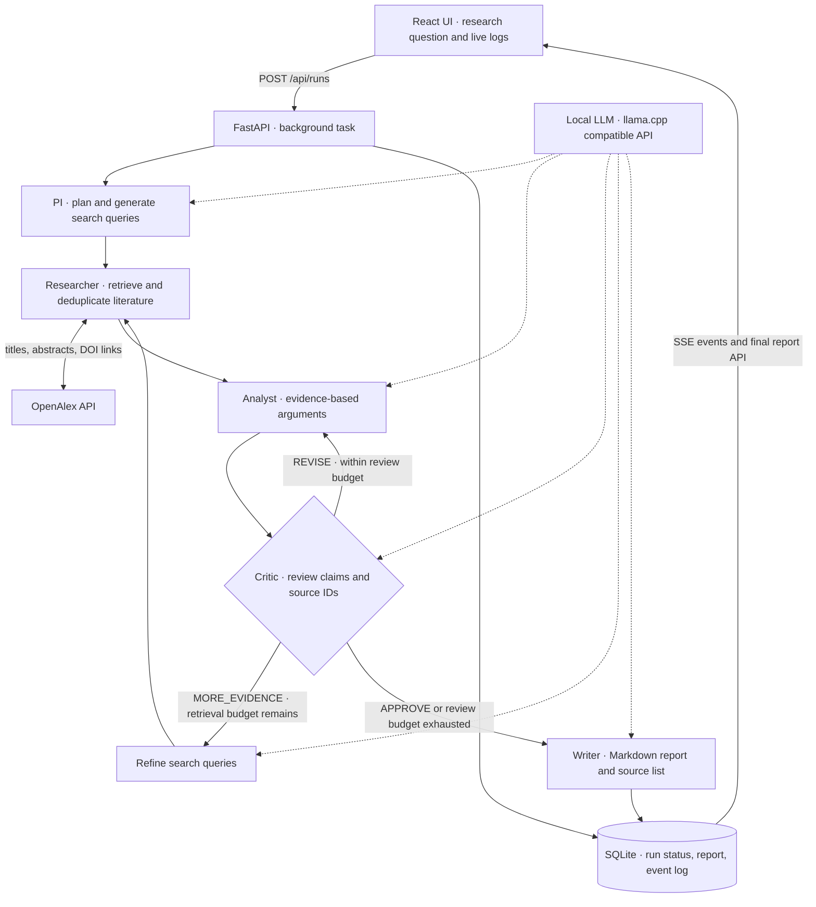

# AI Research Lab

**A local multi-agent research and debate experiment.** Five specialized roles plan research, retrieve literature, analyze evidence, challenge arguments, and produce a cited Markdown report.

Personal project · 2026–present · Python · LangGraph · LangChain · FastAPI · SQLite · React · llama.cpp

The first research question: **Will end-to-end AI replace traditional modular ADAS architectures by 2030?** The question is configurable; this is a research workflow, not an autonomous-driving system. Any conclusions are exploratory and require human review.

## Architecture



All roles share the configured model with distinct prompts. SQLite records execution history; it does not checkpoint LangGraph state. See [architecture details](docs/architecture.md).

## What is implemented

- Conditional LangGraph routing with reviewer-driven follow-up searches and bounded revision loops.
- Dynamic literature queries, OpenAlex retrieval, URL deduplication, and structured source IDs.
- Asynchronous FastAPI runs, live server-sent events (SSE), and persistent execution logs.
- Source-ID validation, unresolved-review notices, and downloadable Markdown reports.
- Local model inference through a configurable OpenAI-compatible endpoint; no OpenAI-hosted model is required.

## Run locally

Requirements: Python 3.11+, Node.js 20+, a running llama.cpp server exposing `/v1/chat/completions`, and network access to OpenAlex. Model weights and the inference server are supplied separately; choose a model your hardware supports.

```bash
cd backend
python3 -m venv .venv
source .venv/bin/activate
pip install -r requirements.txt
cp .env.example .env
# Set LLM_BASE_URL and LLM_MODEL for your local inference server.
# Set OPENALEX_API_KEY if needed for your OpenAlex access.
uvicorn main:app --host 127.0.0.1 --port 8001 --reload
```

In another terminal:

```bash
cd frontend
npm install
npm run dev
```

Open <http://127.0.0.1:5173>. The UI expects the backend at `http://127.0.0.1:8001`. API documentation: <http://127.0.0.1:8001/docs>.

## Project layout

```text
backend/main.py          Agent graph, retrieval, API, SQLite and SSE
backend/requirements.txt Backend dependencies
backend/.env.example     Configuration template without secrets
frontend/src/main.jsx    Research input, live workflow and report download
frontend/src/style.css   UI styles
docs/architecture.md     Execution flow, API and design limits
```

## Current limits and next steps

This is an early prototype. Run one backend worker: tasks execute in-process and do not survive a restart. Retrieval uses paper metadata and available abstracts, not full texts. Citation checks validate identifiers, not whether a paper supports a claim. Reaching the review limit can produce a report with unresolved concerns explicitly flagged.

Next: reliable task recovery, retrieval and citation evaluation, automated workflow tests, and a history/reconnect UI. Local secrets, execution databases, virtual environments, and migration snapshots are excluded from version control.
