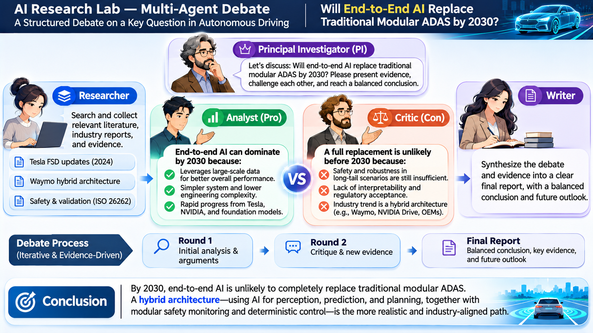
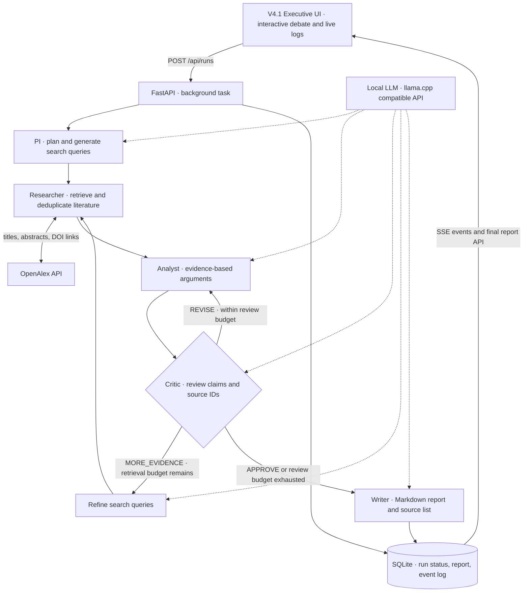

# AI Research Lab

## [▶ Live Interactive Demo](https://yaliai.github.io/ai-research-lab/)

Explore the animated five-agent Debate Arena: PI frames the question, Researcher
retrieves evidence, Analyst develops arguments, Critic challenges them, and Writer
synthesizes a report. The public site opens the Arena and automatically plays a
scripted debate, with pause, resume, replay and all four presentation sections.

**Public showcase:** browser-only scripted dialogue; no live LLM inference, backend
connection, paper retrieval or research execution. **Full local system:** real
research runs using your locally hosted model and backend, with SSE events and
persisted reports. Live Research is disabled on the public site.

**A local multi-agent research and debate experiment.** Five specialized roles plan research, retrieve literature, analyze evidence, challenge arguments, and produce a cited Markdown report.

Personal project · 2026–present · Python · LangGraph · FastAPI · llama.cpp · local LLM · OpenAlex · SQLite · Vite

The first research question: **Will end-to-end AI replace traditional modular ADAS architectures by 2030?** The question is configurable; this is a research workflow, not an autonomous-driving system. Any conclusions are exploratory and require human review.



*Concept illustration of the multi-agent debate and an exploratory conclusion. The implemented workflow is shown below.*

## Architecture



All roles share the configured model with distinct prompts. SQLite records execution history; it does not checkpoint LangGraph state. See [architecture details](docs/architecture.md).

## What is implemented

- Conditional LangGraph routing with reviewer-driven follow-up searches and bounded revision loops.
- Dynamic literature queries, OpenAlex retrieval, URL deduplication, and structured source IDs.
- Asynchronous FastAPI runs, live server-sent events (SSE), and persistent execution logs.
- Source-ID validation, unresolved-review notices, and downloadable Markdown reports.
- Local model inference through a configurable OpenAI-compatible endpoint; no OpenAI-hosted model is required.
- V4.1 Executive homepage with four sections, an animated five-agent Debate Arena, offline Demo Mode, Live Research, and run reconnection.

## Technology stack

LangGraph orchestrates the five roles; FastAPI exposes run/report/SSE APIs;
llama.cpp serves a local LLM; OpenAlex retrieves literature; SQLite stores runs,
events and reports; Vite builds the frontend. The public Pages build uses only
HTML, CSS and browser JavaScript from the same V4.1 interface source.

## Run locally

Requirements: Python 3.11+, Node.js 20+, a running llama.cpp server exposing `/v1/chat/completions`, and network access to OpenAlex. Model weights and the inference server are supplied separately; choose a model your hardware supports.

For a fresh installation (reuse existing model/backend services if already running):

```bash
git clone https://github.com/YALIAI/ai-research-lab.git
cd ai-research-lab/backend
python3 -m venv .venv
source .venv/bin/activate
pip install -r requirements.txt
cp .env.example .env
# Set LLM_BASE_URL and LLM_MODEL for your local inference server.
# Set OPENALEX_API_KEY if needed for your OpenAlex access.
uvicorn main:app --host 127.0.0.1 --port 8091 --reload
```

In another terminal:

```bash
cd frontend
npm install
npm run dev
```

Open <http://localhost:5174>. The UI expects the backend at `http://127.0.0.1:8091`. API documentation: <http://127.0.0.1:8091/docs>.

The V4.1 homepage opens the five-agent Debate Room. See [frontend instructions](frontend/README.md) for production serving and browser checks. Reuse existing backend and model services when already running.

## Project layout

```text
backend/main.py          Agent graph, retrieval, API, SQLite and SSE
backend/requirements.txt Backend dependencies
backend/.env.example     Configuration template without secrets
frontend/index.html      V4.1 Executive Interface, demo, live events and reports
frontend/vite.config.ts  Homepage build and same-origin API proxy
docs/architecture.md     Execution flow, API and design limits
```

## Current limits and next steps

This is an early prototype. Run one backend worker: tasks execute in-process and do not survive a restart. Retrieval uses paper metadata and available abstracts, not full texts. Citation checks validate identifiers, not whether a paper supports a claim. Reaching the review limit can produce a report with unresolved concerns explicitly flagged.

Next: reliable task recovery, retrieval and citation evaluation, automated workflow tests, and a searchable run-history UI. Local secrets, execution databases, virtual environments, and migration snapshots are excluded from version control.

## GitHub Pages deployment

The canonical UI is `frontend/index.html`; the legacy executive HTML address is
a compatibility link. No separate copy of the public interface is maintained.

```bash
cd frontend
npm ci
npm run build:pages
npm run test:pages
npm run preview:pages
# Static showcase at http://127.0.0.1:5175/
```

`build:pages` emits only the public showcase and compatibility entry into
`frontend/dist-pages/`, with relative URLs that support `/ai-research-lab/`.
It removes the local research controls, adapter and configuration. The normal
`npm run build` / `npm run dev` retain the full local workflow.

The [deployment workflow](.github/workflows/deploy-pages.yml) builds, runs browser
checks at desktop/tablet/mobile sizes, uploads the static artifact and deploys it
using GitHub's Pages actions. It runs on frontend changes to `main`, or manually.
It publishes only `frontend/dist-pages/`, never the backend or runtime data.

**One-time repository setup:** open **Settings → Pages → Build and deployment →
Source → GitHub Actions**. Then open **Actions → Deploy interactive debate
showcase** and run (or re-run) the workflow on `main`. The Pages URL is
<https://yaliai.github.io/ai-research-lab/>. If Pages has not been enabled, the
configure/deploy job cannot publish and the URL may return 404 until this setup
is completed. No extra secrets or personal access token are needed by the workflow.
